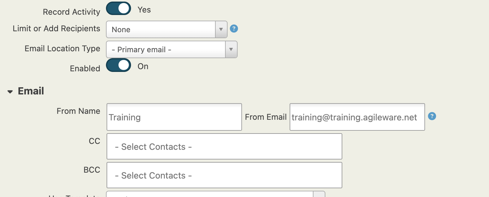

# Scheduled Reminder CC Recipients (au.com.agileware.scheduledccrecipients)

This is a [CiviCRM](https://civicrm.org) extension that adds CC and BCC fields to the
**Scheduled Reminders** (Schedule Reminders) form, allowing you to send a carbon copy or blind
carbon copy of a scheduled reminder email to additional contacts who are not themselves recipients
of the reminder.

This is useful, for example, if you want to notify an event coordinator or staff member whenever a
scheduled reminder email is sent to a Participant, Member, or other recipient, without needing to
add that person as a recipient of the reminder itself.

The extension is licensed under [AGPL-3.0](LICENSE.txt).

## No core patch needed

Earlier versions required a patch to CiviCRM core (adding `token_params` to the parameters passed
to `hook_civicrm_alterMailParams`). That is no longer the case: core already passes `groupName`,
`entity` and `entity_id` for scheduled reminders, which is all this extension needs to recognise
them. If you applied the old patch, it is harmless and can stay or be removed.

## Getting Started

1. Install and enable this extension (see [Installation](#installation-web-ui) below).
2. No further configuration is required. No settings page, API keys, or additional permissions are
   needed beyond the standard CiviCRM permission to administer Scheduled Reminders
   (`administer CiviCRM` / access to "Administer / Communications / Schedule Reminders").

## Usage

1. Go to "Administer / Communications / Schedule Reminders" and add or edit a Scheduled Reminder.
2. New **CC** and **BCC** fields appear on the form, immediately after the **From Email Address**
   field. Use these to select one or more CiviCRM Contacts to receive a copy or blind copy of the
   reminder email.

   

3. Save the Scheduled Reminder as usual. The CC/BCC contacts are stored against that reminder.
4. When the Scheduled Reminder job runs and sends the reminder email, the selected CC and BCC
   contacts' email addresses are added to the outgoing message in addition to the reminder's
   configured recipients.

If a CC or BCC contact has no email address, or has multiple/no matching email, they are silently
skipped for that address type (only contacts with a resolvable email are included).

### Data storage and API

CC/BCC selections are stored per-reminder in a custom table (`civicrm_scheduledreminderdata`),
linked to the Scheduled Reminder (`ActionSchedule`) by `reminder_id`. This extension exposes a
`ScheduledReminderData` API (v3) with standard `get`, `create`, and `delete` actions, should you
need to inspect or script against this data directly.

## Requirements

* CiviCRM 5.51+

## Installation (Web UI)

Learn more about installing CiviCRM extensions in the [CiviCRM Sysadmin
Guide](https://docs.civicrm.org/sysadmin/en/latest/customize/extensions/).

## Running the tests

The PHPUnit tests in `tests/phpunit` run inside a CiviCRM site (they use CiviCRM's headless test
database). On a DDEV CiviCRM site, with the extension installed, set the headless database DSN once
(`cv ev '\Civi\Cv\Config::update(...)'`, see the shared workflow) and then, from the extension
folder:

    phpunit9 --do-not-cache-result

They also run on every push and pull request through `.github/workflows/phpunit-tests.yml`, which
calls the shared `agileware/ci-workflows` PHPUnit workflow.

## About the Authors

This CiviCRM extension was developed by the team at
[Agileware](https://agileware.com.au).

[Agileware](https://agileware.com.au) provide a range of CiviCRM
services including:

* CiviCRM migration
* CiviCRM integration
* CiviCRM extension development
* CiviCRM support
* CiviCRM hosting
* CiviCRM remote training services

Support your Australian [CiviCRM](https://civicrm.org) developers,
[contact Agileware](https://agileware.com.au/contact) today!

